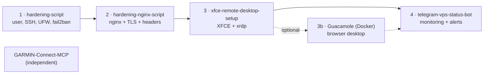

# VPS Setup Guide — which repo to run, in what order, and why

This repo contains no code. It is the **map** for a small set of scripts that
take a fresh Debian/Ubuntu VPS to a hardened server with a web front end, a
remote desktop you can reach from your browser, and a Telegram bot that
watches all of it.

Each step lives in its own repo. Run them **in the order below** — later steps
rely on what earlier steps set up, and running them out of order can lock you
out or silently undo your firewall rules.

---

## At a glance

| Order | Repo | What you get | Required? |
|:---:|---|---|---|
| **1** | [hardening-script](https://github.com/sheloab/hardening-script) | Admin user, locked-down SSH, firewall (UFW), fail2ban, kernel hardening, NTP, logging | **Yes — always first** |
| **2** | [hardening-nginx-script](https://github.com/sheloab/hardening-nginx-script) | nginx with security headers, modern TLS, rate limits, safe rollback | If you serve anything on the web |
| **3** | [xfce-remote-desktop-setup](https://github.com/sheloab/xfce-remote-desktop-setup) | XFCE desktop + xrdp (RDP, port 3389) | If you want a graphical desktop |
| (3b) | Apache Guacamole in Docker — *your own stack, not in this series* | The desktop in a browser tab, behind nginx | Optional |
| **4** | [telegram-vps-status-bot](https://github.com/sheloab/telegram-vps-status-bot) | Status, bans, sessions and alerts in Telegram | Recommended, last |
| Extra | [GARMIN-Connect-MCP](https://github.com/sheloab/GARMIN-Connect-MCP) | Garmin Connect data for AI assistants (MCP server) | Independent — any time, any machine |



---

## Before you start

You need:

- A **fresh** Debian 11/12/13 or Ubuntu 20.04+ VPS with root or sudo access
  (step 2 asks for Debian 12+/Ubuntu 22.04+).
- Your **current public IP address** — step 1 only lets SSH in from the IPs you list.
- Your VPS provider's **web/serial console** login, as a way back in if a
  firewall mistake ever locks you out of SSH.
- For step 2 with HTTPS: a **domain name** pointing at the server.
- For step 4: a **Telegram** account.

Use HTTPS for every `git clone` in this guide (`https://github.com/...`).
After step 1 the server can no longer make outgoing SSH connections
(port 22 out is not on the allow list), so `git@github.com:` URLs will fail.

---

## Step 1 — hardening-script (always first)

**Repo:** https://github.com/sheloab/hardening-script

### Why it goes first

- It starts its firewall setup with `ufw --force reset`, which **deletes every
  existing UFW rule**. Any rule you add before it (or before re-running it) is
  wiped. Run it first, then add your own rules on top.
- It creates the admin user the other steps use, and it upgrades the system.

### Configure

Edit the block at the top of `hardening_script.sh`. The script refuses to run
while any `CHANGE_ME_*` value is left:

| Setting | Default | What to put |
|---|---|---|
| `NEW_USER` | `guest` | The admin user it creates (the rest of this guide assumes `guest`) |
| `NEW_USER_PASSWORD` | `CHANGE_ME_STRONG_PASSWORD` | A strong password — also used later for the RDP desktop login |
| `NEW_HOSTNAME` | `CHANGE_ME_HOSTNAME` | Server name |
| `ALERT_EMAIL` | `CHANGE_ME_ALERT_EMAIL` | Where fail2ban sends notices |
| `SSH_ALLOWED_IPS` | `CHANGE_ME_YOUR_CURRENT_IP` | **Your** IP(s), space-separated. Only these can reach SSH afterwards |
| `NEW_USER_SSH_PUBKEY` | empty | Optional public key. If set, SSH becomes key-only |
| `TIMEZONE` | `UTC` | Any `timedatectl list-timezones` value |

### Run

```bash
git clone https://github.com/sheloab/hardening-script.git
cd hardening-script
nano hardening_script.sh          # fill in the settings above
sudo bash hardening_script.sh
```

It counts down 10 seconds (Ctrl+C aborts). If your current SSH address is not
in `SSH_ALLOWED_IPS`, it makes you type `IUNDERSTAND` before continuing.

**Before closing your session:** open a **new** terminal and confirm you can
still SSH in as the new user. Then `sudo reboot` (needed for the IPv6/GRUB and
sysctl changes).

### What the server looks like afterwards

| Area | Result |
|---|---|
| SSH | Root login off, `AllowUsers <NEW_USER>` (only that user can SSH in), TCP and X11 forwarding off (no SSH tunnels) |
| sudo | `NEW_USER` gets **passwordless** sudo (`NOPASSWD: ALL`). Step 4 relies on this. The repo README shows how to require a password instead |
| Firewall in | Everything denied, **except** your `SSH_ALLOWED_IPS`, which may reach SSH and every other port |
| Firewall out | Everything denied, **except** DNS (53), HTTP (80), HTTPS (443), NTP (123/udp), SMTP (25, 587) and replies to your allowed IPs |
| fail2ban | Jails `sshd`, `recidive` and `portscan` (the bot in step 4 reads these) |
| IPv6 | Disabled |
| Logs | `/var/log/hardening_script.log` (full run log), UFW logging on |

Everything later in this guide works inside those outgoing rules: package
installs, Docker image pulls, Let's Encrypt, `uv`, the Telegram API and the
Garmin API all use ports 80/443.

---

## Step 2 — hardening-nginx-script

**Repo:** https://github.com/sheloab/hardening-nginx-script

### Why now

nginx is the public front door for anything you serve, including Guacamole in
step 3b, and steps 3b and 4 read its logs. Harden it before you put anything
behind it.

### Open the web ports first

The script does **not** touch the firewall, and after step 1 nobody except
your allowed IPs can reach the server. If the site should be public:

```bash
sudo ufw allow 80/tcp  comment "HTTP"
sudo ufw allow 443/tcp comment "HTTPS"
```

### Configure and run

```bash
git clone https://github.com/sheloab/hardening-nginx-script.git
cd hardening-nginx-script
cp hardening_nginx.conf.example hardening_nginx.conf
nano hardening_nginx.conf          # at least set DOMAIN=
sudo ./hardening_nginx_v4.sh hardening_nginx.conf
```

It installs nginx if it is missing, backs up the current config to
`/etc/nginx/backups/<timestamp>/`, writes `conf.d/security-headers.conf` and
`conf.d/hardening.conf`, and rolls everything back if `nginx -t` fails.

### Get a certificate

The example HTTPS server block it writes
(`/etc/nginx/conf.d/secure-site-example.conf.disabled`) expects a Let's Encrypt
certificate in `/etc/letsencrypt/live/<DOMAIN>/`. The script does not request
one. With port 80 open, for example:

```bash
sudo apt install certbot python3-certbot-nginx
sudo certbot --nginx -d your-domain.example
```

Then adapt and enable the example block.

### Watch out

- A `server`/`location` block that sets **its own** `add_header` loses the global
  security headers. Add `include /etc/nginx/conf.d/security-headers.conf;`
  inside it (the example block shows how).
- Check the result at https://securityheaders.com and https://www.ssllabs.com/ssltest/.

---

## Step 3 — xfce-remote-desktop-setup

**Repo:** https://github.com/sheloab/xfce-remote-desktop-setup

### Why now

The desktop is what step 3b (Guacamole) shows in the browser, and the bot in
step 4 checks xrdp and lists desktop sessions.

### Run

```bash
git clone https://github.com/sheloab/xfce-remote-desktop-setup.git
cd xfce-remote-desktop-setup
sudo bash install_xfce_xrdp.sh
```

It installs XFCE, LightDM and xrdp, sets the server to boot into graphical
mode, and starts xrdp on port **3389**. It is safe to re-run.

### Connecting

- Log in as `guest` with the password from step 1, using any RDP client
  (Remmina, Windows Remote Desktop, FreeRDP).
- Thanks to step 1, port 3389 is reachable **only from your `SSH_ALLOWED_IPS`**.
  Keep it that way — do not open 3389 to the internet. For access from anywhere,
  use Guacamole behind nginx (3b) instead.

---

## Step 3b (optional) — Apache Guacamole in Docker

Not part of this series; bring your own Guacamole + Docker setup. If you want
step 4's Guacamole alerts to work out of the box, match what the bot expects:

| Bot expects | Value |
|---|---|
| Container names | `guacstack-guacamole`, `guacstack-guacd`, `guacstack-postgres` |
| Database / DB user | `guacamole_db` / `guacamole_user` |
| Web app (local) | `http://127.0.0.1:8080/guacamole/` |
| nginx logs | `/var/log/nginx/<your-domain>-access.log` and `-error.log` |

Other names work too — change them in the bot's `bot.py`.

Two firewall points:

- **Docker can bypass UFW.** Ports you publish with Docker are reachable even
  if UFW denies them
  ([Docker docs](https://docs.docker.com/engine/network/packet-filtering-firewalls/)).
  Publish Guacamole only on `127.0.0.1` and let nginx proxy it.
- **guacd must reach xrdp.** After step 1, incoming connections to 3389 are
  denied unless they come from your allowed IPs, and that includes the Docker
  network guacd runs in. Allow that network's subnet, e.g.
  `sudo ufw allow from <docker-subnet> to any port 3389 proto tcp`
  (find it with `docker network inspect <network>`).

---

## Step 4 — telegram-vps-status-bot (last)

**Repo:** https://github.com/sheloab/telegram-vps-status-bot

### Why last

It reports on everything above: the fail2ban jails and UFW rules from step 1,
nginx from step 2, xrdp from step 3, and the Guacamole containers from 3b.
Installed earlier, most of its checks would show as missing.

### What it needs from earlier steps

- **Passwordless sudo** for its user — step 1 sets this up for `guest`.
- **Outgoing HTTPS** to Telegram — step 1 already allows port 443 out. No new
  firewall rule is needed; the bot only connects outward.
- Python 3.8 or newer (Debian/Ubuntu ship it).

### Install (short version)

1. Create a bot with **@BotFather** and get your numeric ID from **@userinfobot**.
2. As `guest`:
   ```bash
   git clone https://github.com/sheloab/telegram-vps-status-bot.git ~/telegram-vps-status-bot
   cd ~/telegram-vps-status-bot
   cp bot.env.example bot.env && chmod 600 bot.env && nano bot.env
   ```
3. Install the systemd service from `deploy/` and start it — full steps,
   optional settings and the path/user table are in the bot's README.

You can add your own Linux commands as Telegram buttons; the bot repo's
`docs/ADD-YOUR-OWN-COMMAND.md` walks through it.

### Partial setups

The bot still runs if you skipped 2, 3 or 3b — those checks show as down or
empty. Without Guacamole, its restart watcher reports the three `guacstack-*`
containers as missing after each reboot.

---

## Extra — GARMIN-Connect-MCP (independent)

**Repo:** https://github.com/sheloab/GARMIN-Connect-MCP

Not tied to the server steps — use it on a laptop or on this server, before or
after anything else. It is an MCP server that lets an AI assistant read your
Garmin Connect data (sleep, recovery, training load, runs, gear and more). It
includes a **demo mode with fictional data**, so you can try it without a
Garmin account.

On a server hardened by step 1 it works without firewall changes: the `uv`
installer and the Garmin API both use HTTPS (443) out. If you use its HTTP
transport, keep it on `127.0.0.1` (its default example) rather than exposing it.

Quick start (details in its README): `git clone`, `uv sync`, copy
`.env.example` to `.env`, `uv run garmin-mcp login`, then
`uv run garmin-mcp doctor --live`.

GARMIN-Connect-MCP is built on
**[kavakoss/mcp-garmin-connect](https://github.com/kavakoss/mcp-garmin-connect)**
by [kavakoss](https://github.com/kavakoss) — the original server, Garmin client,
caching layer, running tools, demo mode and test suite are their work, shared
under the MIT License. Thank you. 🙏

---

## After everything: who can reach what

| Port / service | From the internet | From your `SSH_ALLOWED_IPS` | Set by |
|---|---|---|---|
| 22 SSH | ❌ | ✅ (only user `guest`) | Step 1 |
| 80 / 443 nginx | ✅ only if you ran the `ufw allow` above | ✅ | Step 2 + your rule |
| 3389 RDP | ❌ (keep it closed) | ✅ | Steps 1 + 3 |
| Guacamole | via nginx on 443 | via nginx on 443 | Step 3b |
| Telegram bot | no listening port — it connects out | — | Step 4 |

---

## Troubleshooting

| Symptom | Likely cause | Fix |
|---|---|---|
| SSH refused after step 1 | Your IP is not in `SSH_ALLOWED_IPS`, or it changed | Log in through the provider's web console, then `sudo ufw allow from <your-ip> to any port 22 proto tcp` |
| `git clone git@github.com:...` hangs | Outgoing port 22 is blocked by step 1 | Use the `https://` URL |
| Website unreachable after step 2 | Ports 80/443 not opened | `sudo ufw allow 80/tcp` and `sudo ufw allow 443/tcp` |
| certbot fails | Port 80 closed, or the domain's DNS doesn't point at the server | Open 80, check DNS |
| Headers missing on one site | That block defines its own `add_header` | Include `security-headers.conf` inside it |
| RDP connection refused | Connecting from an IP that is not allowed | Connect from an allowed IP, or use Guacamole |
| Guacamole can't open the desktop | Docker network not allowed to 3389 | Add the `ufw allow from <docker-subnet> ... 3389` rule |
| Your own UFW rules disappeared | Step 1 was re-run (`ufw --force reset`) | Re-add your rules after every run of step 1 |
| Bot doesn't answer | Wrong token / chat ID, or service stopped | `journalctl -u telegram-vps-status-bot -f` |

---

## Built on

These scripts configure great open-source software: Debian/Ubuntu, OpenSSH,
UFW, fail2ban, chrony, nginx, Let's Encrypt/certbot, XFCE, LightDM, xrdp,
Apache Guacamole, Docker and the Telegram Bot API — plus
[kavakoss/mcp-garmin-connect](https://github.com/kavakoss/mcp-garmin-connect)
for the Garmin server.

## Disclaimer

Read each script before running it, especially the firewall and SSH parts.
Test on a server you can rebuild. Use at your own risk.
